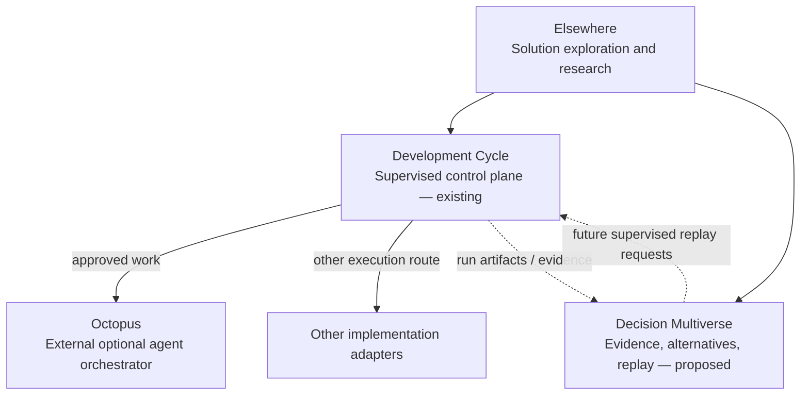

# elsewhere.

Explore how AI agents might help people examine multiple possible solutions before committing to a consequential decision. This is an early-stage research proposal, not a validated decision-replay or counterfactual engine.

**Same same, but different.**

*From problems to possibilities to outcomes.*

We build **solutions**, not software for its own sake. Elsewhere is an early-stage, open research direction into how people and AI agents could explore consequential choices rather than following a single path to a result.

**Status: research proposal.** No decision replay engine, counterfactual outcomes or scientific claims have been established. An unexecuted path is a hypothesis, not a measured result.

## The three pieces

[Development Cycle](https://github.com/Jhacarreiro/openclaw-development-cycle) is an existing tool for durable, supervised execution, validation, and delivery. Octopus is an **external, optional** implementation adapter. Decision Multiverse is **proposed research**, initially observing completed runs rather than controlling execution.

No fixed number, taxonomy, or shape of branches will be imposed on an agent. Alternatives depend on what each decision actually means; sometimes there may be none. Explanations inferred after a run must be clearly distinguished from contemporaneously recorded choices and evidence.

## What we are trying to establish

- Can we identify **consequential decisions** in a real run without drowning in trivial steps?
- Can we faithfully preserve decision **provenance**, distinguishing observed evidence from post-hoc interpretation?
- Can an alternative be revisited from a sufficiently comparable state without leaking hindsight?
- Does exploring alternative paths produce better **real solutions** than investing the same resources in a single path?
- Which decisions benefit from human taste, context and judgment, and at what cost?

## Web interface prototype (planned)

A [v0.1 implementation brief](briefs/web-v0.1.md) describes a small problem-first web UI that presents **existing Development Cycle capabilities** and its optional external Octopus adapter. The Decision Multiverse appears only as an honestly labeled **Coming soon** concept. No new decision engine or operational integration is claimed or authorized by the brief.

The [v0.2 product contract](briefs/web-v0.2.md) extends that prototype vision to GitHub accounts/repositories, decision-first supervision, bounded autonomous mode, audit trails and durable run history. These are **proposed staged capabilities**, not currently available features.

## Research documents

- [Decision Multiverse roadmap](docs/ROADMAP.md) — staged milestones and acceptance criteria
- [Decision provenance inventory](docs/DECISION_PROVENANCE.md) and [decision record v0](docs/DECISION_RECORD.md) — Phase 1 steps 1 and 2
- [Decision map](docs/DECISION_MAP.md) — read-only extractor, relevance filter, static HTML map (Phase 1 steps 3 to 7) and generator of contextual alternatives shown in the map (Phase 2 steps 2 and 3)
- [The Roads Not Taken — working thesis](docs/THESIS_DRAFT.md) — central argument, hypotheses and falsification risks
- [Conversation synthesis](docs/CONVERSATION_NOTES.md) — key choices, conclusions and unresolved questions

## Experiments being considered

| Experiment | Status | Intended question |
| --- | --- | --- |
| [App Growth Lab — B2C mobile acquisition](experiments/app-growth-lab.md) | **Proposed; not run** | Can a solution-led process frame, test and learn from one consumer-app acquisition funnel? |

Experiments are **candidate briefs, not product features or validated research results**. Nothing in this repository authorizes launching agents, spending money, publishing campaigns or modifying running services.

## Publication safety

This repository contains portable public research materials, not an operator deployment. Never add internal network addresses, private runtime state, credentials, personal infrastructure layouts, or non-public execution artifacts; the one reviewed exception is listed in the [publication checklist](PUBLICATION.md). Run `npm run audit:public` before publication; CI enforces the same check. See [publication checklist](PUBLICATION.md).
